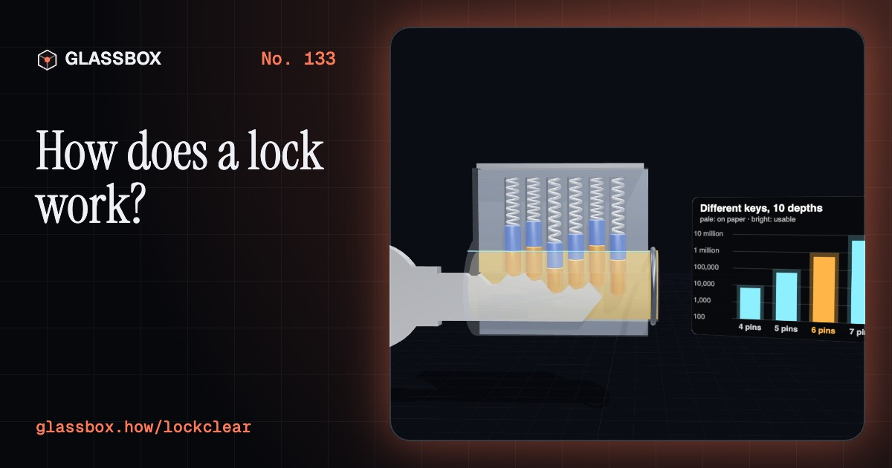
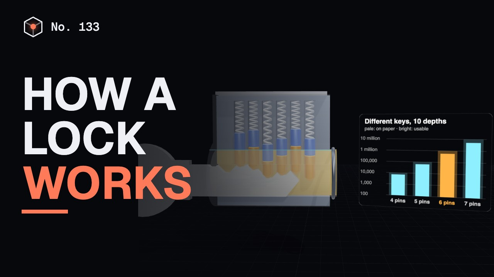
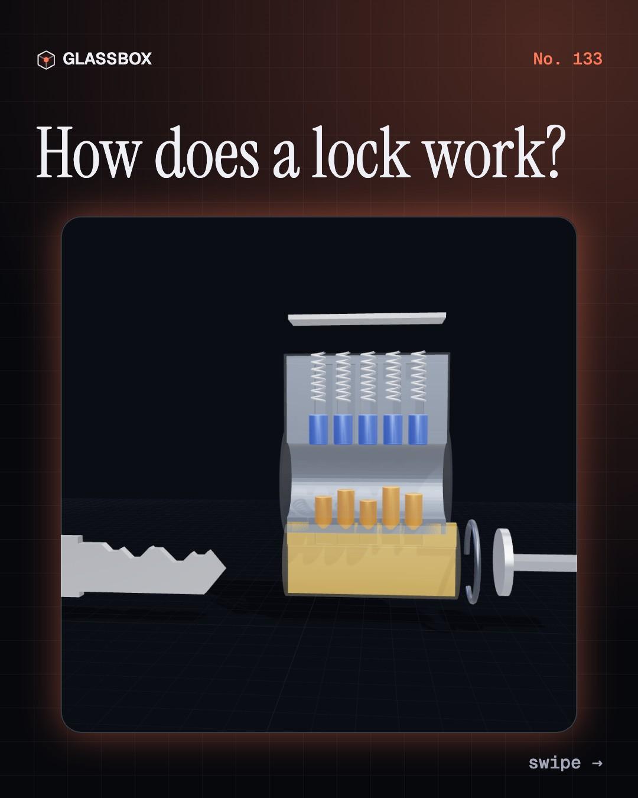
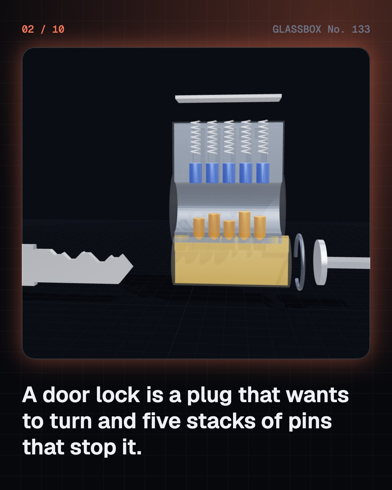
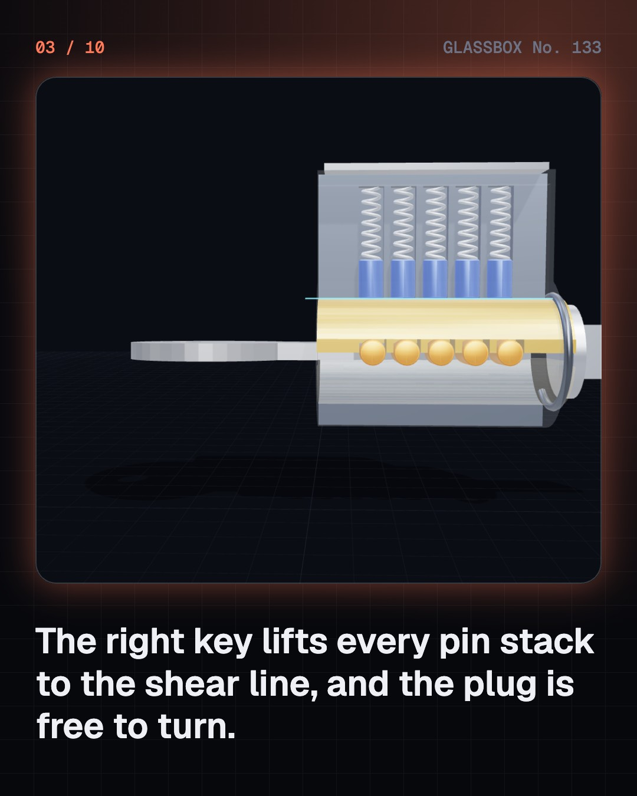
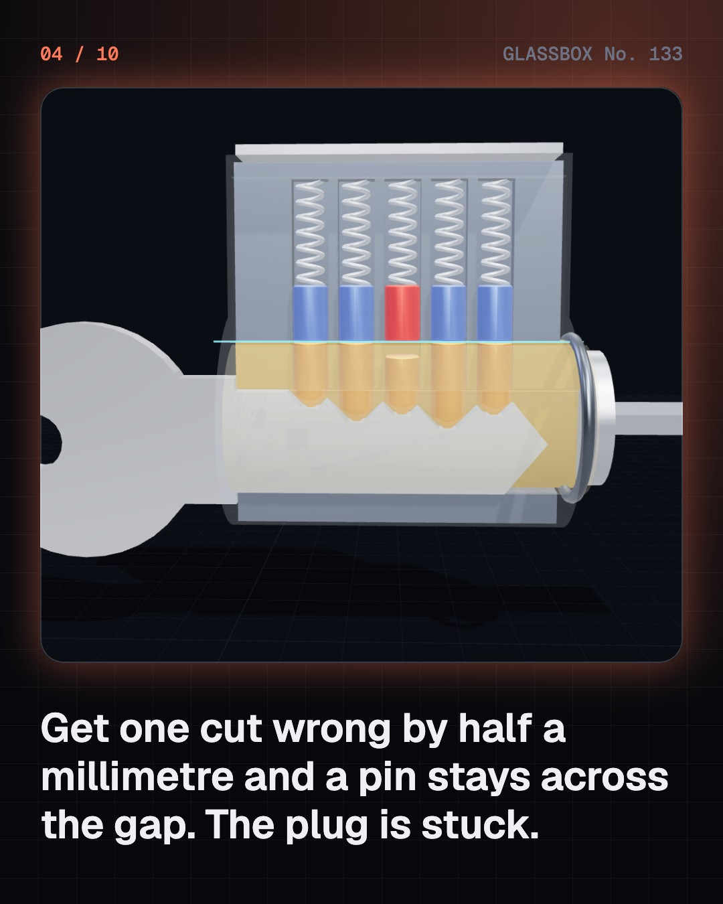

<!-- glassbox:start -->
<!-- Generated from glassbox.json by the Glassbox hub (npm run readme -- lockclear). Edit glassbox.json, not this block. -->
<p align="center"><a href="https://glassbox.how/e/lockclear/"></a></p>

<h1 align="center">LockClear</h1>

<p align="center"><b>How does a lock work?</b><br>Slide a key into a lock cut in half and watch five tiny pin stacks rise to one line. Cut your own key, count the million possible codes, throw a deadbolt, and see what levers, dials and chips do instead.</p>

<p align="center"><a href="https://glassbox.how/lockclear/"><b>▶ Play with it</b></a> &nbsp;·&nbsp; <a href="https://glassbox.how/e/lockclear/">Read the 60-second explainer</a> &nbsp;·&nbsp; <a href="https://glassbox.how/lockclear/glassbox/reel.mp4">Watch the 40-second video</a></p>

<p align="center">
  <a href="https://glassbox.how/e/lockclear/"></a>
  <a href="https://glassbox.how/e/lockclear/"></a>
  <a href="LICENSE"></a>
  <a href="LICENSE-CONTENT.md"></a>
  <a href="#privacy"></a>
</p>

## In 60 seconds

1. **A plug that is pinned in place.** Most door locks are pin-tumbler cylinders. A round plug sits inside a fixed shell, and turning the plug moves the bolt. Five spring-loaded stacks of pins sit in holes drilled through both. With no key, a driver pin in every stack lies across the gap between plug and shell, so the plug cannot turn.
2. **The right key lines up every stack.** Each cut in the key holds one stack at a set height. With the right key, the break between the key pin and the driver pin in every stack lands exactly at the gap, called the shear line. Nothing crosses it, so the plug turns. One cut off by about half a millimetre leaves one pin across the gap, and the lock stays shut.
3. **A code with thousands of answers.** The depths of the cuts are a code. Five pins with six depths give 6 × 6 × 6 × 6 × 6 = 7,776 keys on paper, and six pins with ten depths give a million. More depths need smaller steps, and so tighter machining. Small errors in manufacture are what lock picking takes advantage of, which is why better locks use tighter tolerances, more pins and security pins.
4. **The bolt does the holding.** The cylinder only decides who may turn it. A tailpiece on the back of the plug swings a crank that slides a deadbolt about 25 mm into the door frame. A deadbolt has a square end and no spring, so pushing on it does nothing. A spring latch has a sloped face that lets a door click shut, which also makes it weaker. In a padlock, a cam holds two steel balls in notches in the shackle.
5. **Levers, wards and wafers.** A lever lock, the kind in a steel almirah, lifts flat levers until a slot in each lines up for a peg on the bolt. A warded lock only blocks keys that hit its fixed ridges, so it protects little. A wafer lock, common in drawers and cars, uses one-piece wafers that must sit flush with the plug.
6. **No key at all.** A combination dial parks three notched wheels one at a time until a bar can drop into all three notches. Electronic locks check a code, a card, a fingerprint or a phone with a chip, then a small motor or solenoid moves the same kind of steel bolt.

## Words worth knowing

| Term | Meaning |
|---|---|
| **Pin tumbler lock** | A lock in which spring-loaded stacks of pins stop a plug from turning until the right key lines them up. |
| **Plug** | The round core of a lock cylinder that the key goes into. It is the part that turns. |
| **Shear line** | The gap between the plug and the shell. The plug turns only when no pin crosses it. |
| **Key pin and driver pin** | The lower and upper pins in each stack. The key sets the height of the break between them. |
| **Bitting** | The list of cut depths along a key, such as 3-5-2-6-4. It is the key's code. |
| **Tolerance** | How far a made part may be from its drawn size. Tighter tolerances make a lock harder to fool. |
| **Deadbolt** | A solid bolt with a square end and no spring, moved only by turning the cylinder or a thumb-turn. |
| **Lever lock** | A lock in which the key lifts flat levers until a gate in each lines up with a stump on the bolt. |
| **Combination lock** | A lock opened by turning notched wheels to the right positions instead of using a key. |

## A short history

**4,000 years from a wooden bolt with falling pins to a door that opens for your phone.**

- **2000 BCE** · A wooden bolt with falling pins (Egyptian carpenters, Egypt)
- **50** · Romans make locks of metal (Roman smiths, Roman Empire)
- **1778** · Barron's double-acting lever (Robert Barron, London, England)
- **1790** · The Challenge Lock goes in the window (Joseph Bramah, Piccadilly, London, England)
- **1818** · Chubb's detector lock (Jeremiah Chubb, Portsmouth, England)
- **1844** · Yale's pin-tumbler lock (Linus Yale Sr., Springfield, Massachusetts and Newport, New York)
- **1851** · The Great Lock Controversy (Alfred Charles Hobbs, Great Exhibition, London, England)
- **1861** · The flat key and the cylinder (Linus Yale Jr., Shelburne Falls, Massachusetts)

The full story, with 32 moments, charts, people and 42 sources: [glassbox.how/e/lockclear/history](https://glassbox.how/e/lockclear/history/). The data lives in [`history.json`](history.json).

## Video and slides

Made with the Glassbox studio from this box's storyboard (`window.glassbox.director`). Free to reuse under CC BY 4.0.

<a href="https://glassbox.how/lockclear/glassbox/video.mp4"></a>

<p><a href="glassbox/slide-1.jpg"></a> <a href="glassbox/slide-2.jpg"></a> <a href="glassbox/slide-3.jpg"></a> <a href="glassbox/slide-4.jpg"></a></p>

| File | What | Size |
|---|---|---|
| [`glassbox/reel.mp4`](https://glassbox.how/lockclear/glassbox/reel.mp4) | Reel / Short, with captions and soundtrack | 1080×1920 |
| [`glassbox/video.mp4`](https://glassbox.how/lockclear/glassbox/video.mp4) | YouTube video, with captions and soundtrack | 1920×1080 |
| `glassbox/slide-1…10.jpg` | Instagram carousel | 1080×1350 |
| `glassbox/thumb.jpg` | YouTube thumbnail | 1280×720 |
| `glassbox/cover.jpg` | Share card and repo social preview | 1200×630 |
| [`glassbox/history-reel.mp4`](https://glassbox.how/lockclear/glassbox/history-reel.mp4) | “History in 10 moments” Reel / Short | 1080×1920 |
| `glassbox/history-slide-*.jpg` | History carousel | 1080×1350 |
| `glassbox/post.json` | Post copy and schedule used by the publish kit | |

## Privacy

This box has no accounts and no ads, and it ships its own fonts and libraries. When you run it yourself it sends nothing anywhere. On glassbox.how, the site's `/bar.js` also loads Glassbox's analytics: **Google Analytics** to count visits (it asks first in the EU, UK and Switzerland, and stays off when your browser sends Global Privacy Control or Do Not Track) and **ClickTrust** to detect bots.

It remembers a few things **in your own browser only**, and never sends them anywhere:

| Browser storage key | What it holds |
|---|---|
| `lockclear.v1` | Which chapters you have opened, your best quiz scores, and sound on or off. |

Exactly what each one sees is at [glassbox.how/privacy](https://glassbox.how/privacy/).

## Licences

- **Code:** [MIT](LICENSE). Use it, change it, ship it.
- **Explanations, text, images and videos** (`glassbox.json`, `glassbox/`): [CC BY 4.0](LICENSE-CONTENT.md). Credit “Glassbox, glassbox.how/e/lockclear”.
- **Third-party parts** keep their own licences: [three.js](https://threejs.org) (MIT), [Geist, Instrument Serif](https://openfontlicense.org) (SIL OFL 1.1).
- The Glassbox name and logo aren't covered by either licence. See the [terms](https://glassbox.how/terms/).

Found a mistake? [Open an issue](https://github.com/bdeeps/lockclear/issues). Corrections happen in public.
<!-- glassbox:end -->

## Run it

It's plain HTML, CSS and JavaScript. No build step and no dependencies. Run locally, it contacts no other website.

```bash
python3 -m http.server 8000
```

Three.js and the fonts ship in `vendor/` and `fonts/`, so it also works offline.

Then open http://localhost:8000.

## How it's built

| File | What |
|---|---|
| `index.html`, `css/app.css` | The page and its styles |
| `js/app.js`, `js/stage.js`, `js/ui.js`, `js/kit.js` | The shared Glassbox 3D engine: chapters, 3D stage, controls, quiz, video director |
| `js/lock.js` | The shared lock models and maths: the cut-away pin-tumbler cylinder, key profiles, pin-stack physics and key counting |
| `js/chapters/*.js` | One file per chapter: the 3D model, controls, text, key terms, quiz and video scenes |
| `glassbox.json` | Title, question, explainer beats, key terms, browser storage and credits shown on glassbox.how |
| `reel` in each chapter | The storyboard the Glassbox studio records into short videos |
| `glassbox/` | The published video, slides, thumbnail and post copy |
| `fonts/`, `vendor/three/` | Self-hosted Geist and Instrument Serif (SIL OFL 1.1) and three.js (MIT) |
